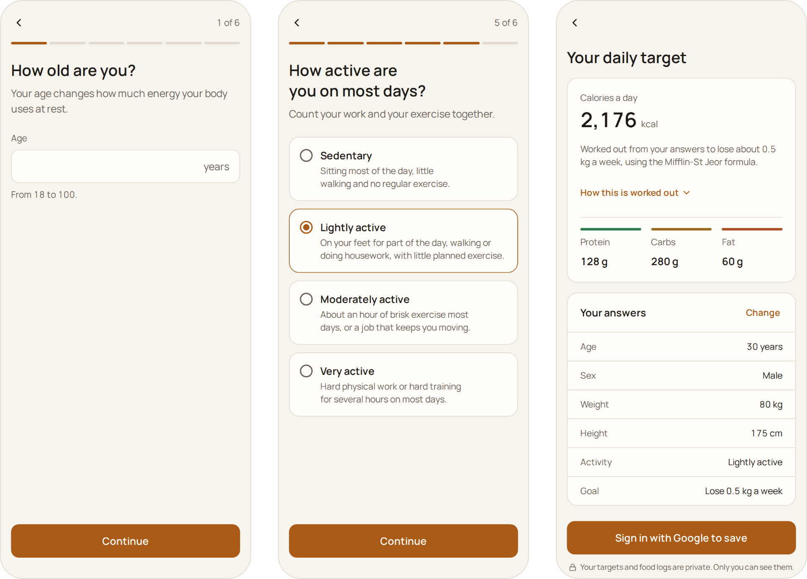

<div align="center">

<h1>
  <picture>
    <source media="(prefers-color-scheme: dark)" srcset="public/brand/logo-on-dark.svg" />
    
  </picture>
</h1>

A calorie and macro tracker for Kashmiri and everyday food.<br />
It runs in the browser and installs on a phone like an app.

[](https://react.dev)
[](https://www.typescriptlang.org)
[](https://vite.dev)
[](https://tailwindcss.com)
[](https://supabase.com)
[](https://www.postgresql.org)
[](https://vitest.dev)
[](https://github.com/features/actions)

[Getting started](#getting-started) · [How the numbers are worked out](#how-the-numbers-are-worked-out) · [Sources](#sources) · [Contributing](CONTRIBUTING.md) · [Security](SECURITY.md)

<picture>
  <source media="(prefers-color-scheme: dark)" srcset="docs/images/start-dark.png" />
  
</picture>

<sub>Two of the six first-run questions, and the daily target they work out.</sub>

</div>

## Overview

- Six questions work out a daily calorie and macro target from cited formulas.
- Sign in with Google. Each person's food logs are private to them.
- Log food by searching or from recent foods, in grams or household units such as piece, cup and katori.
- Every food value comes from a named source and is stored per 100 g.

## Tech stack

| Area            | Tools                                                        |
| :-------------- | :----------------------------------------------------------- |
| App             | React 19, TypeScript, Vite, wouter                           |
| Styling         | Tailwind CSS v4, Lucide React icons                          |
| Fonts           | Manrope (self-hosted with Fontsource)                        |
| Database        | Supabase (PostgreSQL) with row-level security                |
| Sign-in         | Supabase Auth with Google                                    |
| Food data       | USDA FoodData Central (public domain), imported with Python  |
| Tests           | Vitest, React Testing Library, pgTAP, Playwright, axe-core   |
| Lint and format | oxlint, Prettier                                             |
| CI              | GitHub Actions                                               |
| Hosting         | Cloudflare Workers, serving the built files as static assets |

## Project structure

```text
src/
  firstRun/     What signed-out visitors see: the welcome screen and the first-run questions
  screens/      The signed-in screens
  today/, log/  Parts of the Today screen and the log sheet
  shell/        Navigation, the frame around every screen, and how the site names itself
  components/   Shared building blocks
  lib/          Logic kept apart from the screens: nutrition math, targets, food search, logging
  auth/, theme/, profile/
                The session, the theme and the first-run answers, shared with every screen
public/         The favicon, app icons, logo and share image
scripts/        USDA importer, design-token check, security headers, search files, CI helpers
  brand/        Draws the logo, icons and share image from the color tokens
supabase/       Migrations and database tests
e2e/            End-to-end tests
docs/images/    Screenshots for this page
```

## Getting started

You need Node.js 22.12 or newer (`nvm use` reads `.nvmrc`), npm, Docker for the local Supabase stack, and Python 3 for the importer's tests.

```bash
git clone https://github.com/tajamul-wani/shumar.git
cd shumar
nvm use
npm install
```

Copy `.env.example` to `.env.local` and fill in the values (ask a maintainer). Never commit `.env.local`.

| Variable                        | Used for                                                                            |
| :------------------------------ | :---------------------------------------------------------------------------------- |
| `VITE_SUPABASE_URL`             | The Supabase project address                                                        |
| `VITE_SUPABASE_PUBLISHABLE_KEY` | The Supabase publishable key. Never put the secret key here.                        |
| `SITE_URL`                      | The site's own address, for search and share links. `http://localhost:4173` locally |
| `LINEAR_API_KEY`                | Task tracking (maintainers only)                                                    |
| `LINEAR_TEAM_KEY`               | Task tracking (maintainers only)                                                    |

Start the local Supabase stack (the first run downloads its images), then the app at http://localhost:5173:

```bash
npx supabase start
npm run dev
```

### Scripts

| Command             | What it does                                                       |
| :------------------ | :----------------------------------------------------------------- |
| `npm run dev`       | Start the development server                                       |
| `npm run build`     | Type check and build for production, with security headers         |
| `npm run preview`   | Serve the production build locally                                 |
| `npm run brand`     | Draw the logo, icons, favicon and share image into `public/` again |
| `npm run lint`      | Check design tokens, run oxlint and check formatting               |
| `npm run format`    | Format all files with Prettier                                     |
| `npm run typecheck` | Run the TypeScript compiler                                        |
| `npm run test`      | Run the unit tests with coverage, then the importer's tests        |
| `npm run test:db`   | Run the database security tests                                    |
| `npm run test:e2e`  | Run the end-to-end tests                                           |
| `npm run check`     | Lint, type check, unit tests and build                             |

### Deploying

The site is served by Cloudflare Workers as static assets, with no server code. `wrangler.jsonc` points at `dist/` and serves `index.html` for any address that is not a file, so the app's own screens open on a refresh or from a shared link. The build writes `dist/_headers` (the security policy and the `noindex` rules) from `scripts/security-headers.ts` and `scripts/seo.ts`, and Cloudflare applies it to every response.

Deploys run through Cloudflare's Workers Builds, connected to this repository: every push to `main` runs `npm run build` and then `npx wrangler@4.151.1 deploy`. Wrangler is pinned there rather than installed as a dependency, so its own tooling stays out of this project's dependency tree and its audit. `main` only moves through merged pull requests, which need CI to pass first. The build needs `VITE_SUPABASE_URL`, `VITE_SUPABASE_PUBLISHABLE_KEY` and `SITE_URL` (the live address, with `https`) as build variables in the Cloudflare dashboard; none of them is a secret. The Supabase project's redirect list names the live address, so Google sign-in works there and on this machine only.

## Testing

- `npm run check` needs nothing running. `npm run test:db` and `npm run test:e2e` need the local Supabase stack.
- End-to-end tests run on an Android phone, an iPhone, a tablet and a desktop, in both themes, with accessibility checks. The first time, install the browsers with `npx playwright install --with-deps chromium webkit`.
- A pull request into `main` must pass lint and types, unit, database, end-to-end, a security scan and CodeQL.

## Architecture

Shumār is a single-page React app. The data lives in Supabase, and row-level security keeps each person's data private.

- **Signed out**, `src/firstRun/` shows the home page and the public sources and privacy pages, asks the first-run questions and shows the daily target. The answers stay on the device until sign-in and are wiped at sign-out.
- **Calculations** live in `src/lib/`, apart from the screens: `nutrition.ts` (food values), `targets.ts` (daily targets) and `today.ts` (the day's totals). See How the numbers are worked out.
- **Food search** is one database function, `search_foods(query)`: our own catalog first, then USDA foods. The app keeps the day's searches on the device.
- **Trends** read each day's calories, macros and sodium through one database function, `daily_totals(from, to)`, a month at most per call, so a month is at most 31 rows. Tapping a day opens its logs as they were saved.
- **Keys:** the app holds only the project address and the publishable key. `npm run build` writes the security headers from `scripts/security-headers.ts`.
- **Your data:** Download my data builds one JSON file in the browser from the person's own rows. Delete my account calls `delete_my_account()`, which removes the account; the profile and logs go with it through the cascade.
- **Search:** only the home page, the privacy policy and the sources page belong in search results. `npm run build` fills the page's title, description and share links from `src/shell/site.ts` and `SITE_URL`, writes `robots.txt` and `sitemap.xml`, and sends a noindex header with every other screen (`scripts/seo.ts`).

| Table             | Holds                                                        | Who can access it                             |
| :---------------- | :----------------------------------------------------------- | :-------------------------------------------- |
| `kashmiri_foods`  | Our own food catalog, per 100 g, with a source for each food | Anyone can read; nobody can write via the API |
| `food_units`      | Grams in one piece, cup or katori of a catalog food          | Anyone can read; nobody can write via the API |
| `user_logs`       | One row per food logged, with the nutrients at that moment   | Only the person who logged it                 |
| `profiles`        | Each person's first-run answers                              | Only that person                              |
| `usda_releases`   | Which USDA files are loaded, with each file's SHA-256        | Anyone can read                               |
| `usda_foods`      | About 7,100 USDA foods, per 100 g                            | Signed-in people can read                     |
| `usda_portions`   | USDA household portions in grams                             | Signed-in people can read                     |
| `search_synonyms` | Local food words mapped to USDA wording                      | Signed-in people can read                     |

To import a new USDA release: update the file name and SHA-256 in `DATASETS` in `scripts/usda/import_usda.py`, run `python3 scripts/usda/import_usda.py supabase/migrations/<timestamp>_usda_foods_data.sql`, then update the expected counts in `supabase/tests/database/usda_data.test.sql`.

## How the numbers are worked out

### Food values

Every food is stored per 100 g of the food as eaten. A serving works out as:

```math
\text{grams} = \text{amount} \times \text{grams in one unit}
\qquad
\text{nutrient} = \text{value per 100 g} \times \frac{\text{grams}}{100}
```

<details>
<summary>The same as plain text</summary>

```text
grams    = amount × grams in one unit (piece, cup, katori, or 1 for grams)
nutrient = value per 100 g × grams ÷ 100
```

</details>

- A log keeps the values worked out when it was saved, so a later change to a food never rewrites anyone's history.
- Values keep full precision and are rounded only for display: whole kcal and mg, macros to one decimal place.
- The day's totals add up its logs. The sodium alert shows past 2,000 mg a day, the World Health Organization's limit for adults.
- Values come only from named sources: our own measured recipes for Kashmiri dishes, and USDA FoodData Central. The importer leaves out foods with a missing value and flags foods whose calories are more than 20% off their protein, carbs and fat at 4, 4 and 9 kcal per gram.

### Daily targets

`src/lib/targets.ts` turns the first-run answers into daily targets, for adults 18 and over:

```math
\begin{aligned}
\text{resting energy} &= 10w + 6.25h - 5a + s \\
\text{daily energy} &= \text{resting energy} \times \text{PAL} \\
\text{calories} &= \text{daily energy} - \text{gap}, \text{ or daily energy} \times 1.10 \text{ to gain} \\
\text{protein} &= \min\left(p\,w,\ \frac{0.35 \times \text{calories}}{4}\right) \\
\text{fat} &= \frac{0.25 \times \text{calories}}{9} \\
\text{carbs} &= \frac{\text{calories} - 4 \times \text{protein} - 9 \times \text{fat}}{4}
\end{aligned}
```

Here w is weight in kg, h is height in cm and a is age in years. Protein, fat and carbs come out in grams.

<details>
<summary>The same as plain text</summary>

```text
resting energy = 10 × weight in kg + 6.25 × height in cm - 5 × age + s   (s = +5 for men, -161 for women)
daily energy   = resting energy × PAL
calories       = daily energy - gap, or daily energy × 1.10 to gain
protein (g)    = the smaller of p × weight in kg and 0.35 × calories ÷ 4
fat (g)        = 0.25 × calories ÷ 9
carbs (g)      = (calories - 4 × protein - 9 × fat) ÷ 4
```

</details>

| Part          | Numbers                                                                                        | Source                                                                                                                                                                                                                             |
| :------------ | :--------------------------------------------------------------------------------------------- | :--------------------------------------------------------------------------------------------------------------------------------------------------------------------------------------------------------------------------------- |
| s             | +5 for men, -161 for women                                                                     | [Mifflin-St Jeor, 1990](https://doi.org/10.1093/ajcn/51.2.241)                                                                                                                                                                     |
| PAL           | 1.40, 1.53, 1.76 or 2.25, from sedentary to very active                                        | [ICMR-NIN 2020](https://www.nin.res.in/rdabook/brief_note.pdf) for sedentary, [FAO/WHO/UNU 2004](https://www.fao.org/4/y5686e/y5686e00.htm) for the rest                                                                           |
| Gap           | 300, 500 or 750 kcal less to lose 0.25, 0.5 or 0.75 kg a week; none to keep your weight        | [NIH 1998](https://www.nhlbi.nih.gov/files/docs/guidelines/ob_gdlns.pdf), [AHA/ACC/TOS 2013](https://doi.org/10.1161/01.cir.0000437739.71477.ee)                                                                                   |
| Gaining       | 10% over daily energy                                                                          | [Iraki et al. 2019](https://doi.org/10.3390/sports7070154)                                                                                                                                                                         |
| Safety floor  | Losing weight never goes below 1,200 kcal for women or 1,500 for men, or daily energy if lower | [AHA/ACC/TOS 2013](https://doi.org/10.1161/01.cir.0000437739.71477.ee)                                                                                                                                                             |
| p             | 1.6 g per kg of body weight, or 2.2 g for body recomposition, at most 35% of calories          | [Morton et al. 2018](https://doi.org/10.1136/bjsports-2017-097608), [ISSN 2017](https://doi.org/10.1186/s12970-017-0177-8), [Iraki et al. 2019](https://doi.org/10.3390/sports7070154), [IOM 2005](https://doi.org/10.17226/10490) |
| Fat and carbs | Fat is 25% of calories, and carbs get the rest                                                 | [IOM 2005](https://doi.org/10.17226/10490), [WHO](https://www.who.int/news-room/fact-sheets/detail/healthy-diet)                                                                                                                   |

## Sources

Shumār's food values and daily targets come from these sources. Thank you to the people and organisations behind them.

**Food values**

- [USDA FoodData Central](https://fdc.nal.usda.gov/), U.S. Department of Agriculture, Agricultural Research Service. Foundation Foods and SR Legacy, in the public domain.

**Daily targets and alerts**

- Mifflin et al. 1990. [A new predictive equation for resting energy expenditure in healthy individuals](https://doi.org/10.1093/ajcn/51.2.241). Am J Clin Nutr 51(2):241-7.
- ICMR-NIN 2020. [A Brief Note on Nutrient Requirements for Indians, the Recommended Dietary Allowances (RDA) and the Estimated Average Requirements (EAR)](https://www.nin.res.in/rdabook/brief_note.pdf).
- FAO/WHO/UNU 2004. [Human energy requirements](https://www.fao.org/4/y5686e/y5686e00.htm).
- NIH NHLBI 1998. [Clinical Guidelines on the Identification, Evaluation, and Treatment of Overweight and Obesity in Adults: The Evidence Report](https://www.nhlbi.nih.gov/files/docs/guidelines/ob_gdlns.pdf).
- AHA/ACC/TOS 2013. [Guideline for the Management of Overweight and Obesity in Adults](https://doi.org/10.1161/01.cir.0000437739.71477.ee). Circulation 2014;129 suppl 2:S102-38.
- Iraki et al. 2019. [Nutrition Recommendations for Bodybuilders in the Off-Season: A Narrative Review](https://doi.org/10.3390/sports7070154). Sports 7(7):154.
- Morton et al. 2018. [A systematic review, meta-analysis and meta-regression of the effect of protein supplementation on resistance training-induced gains in muscle mass and strength in healthy adults](https://doi.org/10.1136/bjsports-2017-097608). Br J Sports Med 52(6):376-84.
- Jäger et al. 2017. [International Society of Sports Nutrition Position Stand: protein and exercise](https://doi.org/10.1186/s12970-017-0177-8). J Int Soc Sports Nutr 14:20.
- IOM 2005. [Dietary Reference Intakes for Energy, Carbohydrate, Fiber, Fat, Fatty Acids, Cholesterol, Protein, and Amino Acids](https://doi.org/10.17226/10490).
- World Health Organization. [Healthy diet](https://www.who.int/news-room/fact-sheets/detail/healthy-diet) fact sheet.
- World Health Organization 2012. [Guideline: Sodium intake for adults and children](https://www.who.int/publications/i/item/9789241504836).

**Fonts and icons**

- [Manrope](https://fonts.google.com/specimen/Manrope), under the SIL Open Font License 1.1, served with [Fontsource](https://fontsource.org).
- [Lucide](https://lucide.dev) icons, under the ISC License.

## Design system

Colors, fonts, type sizes and weights are tokens in `src/index.css`, used through Tailwind classes such as `bg-koshur-base` and `text-body`. Tailwind's defaults are turned off, and `npm run lint` fails on anything else. Every color has a dark and a light value.

| Color token                                      | Role                          |
| :----------------------------------------------- | :---------------------------- |
| `koshur-base`, `koshur-surface`, `koshur-border` | Background, cards, dividers   |
| `koshur-silk`, `koshur-muted`                    | Primary and secondary text    |
| `deficit-ring`                                   | Calories and primary actions  |
| `macro-protein`, `macro-carb`, `macro-fat`       | Protein, carbs and fat        |
| `alert-surplus`                                  | Over-target states and alerts |

Type sizes: `text-caption` (12 px), `text-body-sm` (14), `text-body` (16), `text-title` (20), `text-heading` (24), `text-display` (32, or 40 from tablets) and `text-hero` (36, or 48 from tablets, for the home page heading only). Weights: 400, 500 and 600. All text uses Manrope.

The logo, app icons, favicon and share image are drawn from these tokens by `npm run brand` (`scripts/brand/`). The mark is the day as a saffron hexagon that fills up, around the protein, carbs and fat drops, with the name beside it. The name's outline comes from Manrope, shaped once with HarfBuzz by `scripts/brand/outline-text.mjs`.

## Contributing

See [CONTRIBUTING.md](CONTRIBUTING.md) for branches, commits, checks and pull requests. To report a security problem, see [SECURITY.md](SECURITY.md).

## License

Copyright © 2026 Tajamul Wani. All rights reserved. See [LICENSE](LICENSE). The fonts and icons keep their own licenses, listed under Sources.
